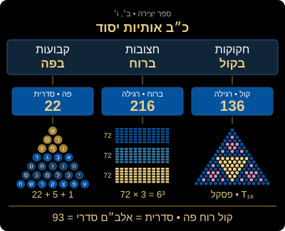
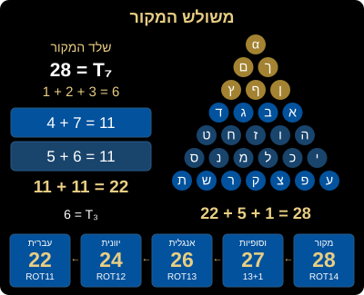
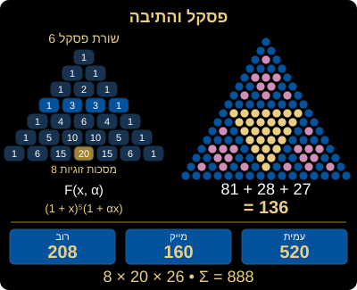
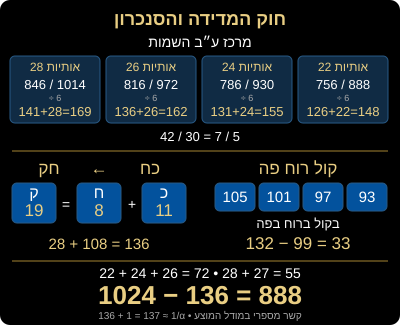

# ROVGRID — מרכז חקירה: ספר יצירה, α28, פסקל, ע״ב ותיבת רוב
27.11.2026 | הנחיית המשתמש: לאמץ את המודל במרכז החקירה, להשתמש בו לחקירה מחדש של הקורפוס המצטבר. החישובים והמשפטים המותנים נבדקו; אין בכך אישור היסטורי או פיזיקלי לכל השערה.

## ארבע המחשות מאושרות לפרסום (שחזור SVG, עברית מימין לשמאל, 400×325, רקע שחור)

## תמצית ואקסיומות
מקור ההשראה: ספר יצירה ב:ו, ״כ״ב אותיות יסוד, חקוקות בקול, חצובות ברוח, קבועות בפה״. שלוש שכבות הניתוח (מילות יסוד, אותיות שימוש והמשפט המלא) נפרדות ושוות במעמדן. קול=136 רגיל, 37 סדרי, 26 אלב״ם סדרי, 32 אתב״ש סדרי, 10 קטן; ברוח=216 רגיל; פה=22 סדרי. קול רוח פה: 93 סדרי=93 אלב״ם סדרי; בקול ברוח בפה: 99/132; הפרש33. קול רוח פה בקינון 22/24/26/28: 93/97/101/105 בשתי המדידות. עם ב': S=55+4k, A=55+7k. בלי ב': S=A=49+4k. 
T7=28=22+5+1. T3=6; 4+7=5+6=11. זוגות משתנים של K4 בתוך K8; α כסמן מצב. ביטול יחידה אחת ואחריה בת זוגה, ואז זוגות: 28→27→26→24→22. F(x,α)=(1+x)^5(1+αx); G(x)=(1+x²)^3. 64 מסכות כלליות, 8 מסכות זוגיות; מקדם מרכזי 20; 26 לאחר ביטול זוג. 8×20×26 פאות 160/208/520; סך 888, נפח4160. פסקל16: 81 אי-זוגיים, 28 מרכז זוגי, 27 יתר זוגיים; סך136. 22+24+26=72, 27+28=55, יחד127.
ע״ב: שלושה פסוקים בני72 אותיות, 216=6³. הציור המתוקן מציג שלוש מטריצות 6×12, לא קובייה מעוותת. במרכז 24 השמות: J=426,L=42,R=30. S=426+30k,A=426+42k; S/6=71+5k,A/6=71+7k; ההפרש 2k. ב-22/24/26/28 הזוגות הם 756/888,786/930,816/972,846/1014; מנורמל 126/148,131/155,136/162,141/169. P(6)=756 ב-ABC∆. 816=6×136,846=6×141. 
כח→חק: סדרי כ=11,ח=8,ק=19; (11,8)→(8,19) לפי (a,b)→(b,a+b). רגילה כח28+חק108=136. המשך 11,8,19,27,46,73. 136+1=137 הוא החלק השלם של ההופכי של קבוע המבנה הדק; אין גזירה פיזיקלית של α. 
1024−136=888; קישורים ל-ABC∆, פסקל, Q10, תגי העדות ומפקד ע״ב. התעתיק האנגלי 1776 שנבחר בחלקו לפי יעד לא מוכח כתוצאה של הקינון.

## ביצוע ואימות קודמים
- [חוק הקינון](../../research/rovgrid-nested-alphabet-shift-law-2026-11-27.md) · [20,566 בדיקות](../../research/rovgrid-nested-alphabet-shift-law-2026-11-27-verify.js)
- [גשרי הקורפוס](../../research/rovgrid-nested-alphabet-shift-corpus-bridges-2026-11-27.md) · [47 בדיקות](../../research/rovgrid-nested-alphabet-shift-corpus-bridges-2026-11-27-verify.js)
- [משולש α28](../../research/rovgrid-triangle28-alpha-pascal-cancellation-2026-11-27.md) · [75 בדיקות](../../research/rovgrid-triangle28-alpha-pascal-cancellation-2026-11-27-verify.js)
- [קול, ספר יצירה ותגי העדות](../../research/rovgrid-kol-136-37-26-witness-tags-2026-11-27.md)
מספר הבדיקות הקודמות אינו מספר ראיות עצמאיות. אין להצהיר שכל הקורפוס אומת מחדש.

## הוראה לכל החוקרים
לאמץ כעדשת מחקר קבועה בצד ABC∆, לא במקום הקורפוס. בכל מחזור לשמור 80% ביקורת החומר המצטבר, 20% חידוש. לחזור תחילה למחקרים ישנים, לזהות מופעים של חוקי הזוגות, ההכלה המשולשית, שימור המדידות, 28/55/136/888/1024, ולגזור תחזיות לפני חישוב. לתעד גם כישלונות וחסמים.
MATTER: אלגברה, מבני גרף ופסקל, הוכחות והרחבות. MIRROR: מראות, תעתיק, שימור ושבירת סימטריה. SPIRIT: מקורות ספר יצירה, ע״ב, חילופי נוסח ומשמעות; להפריד מקור מהצלבה. ARCHIVIST: אינדוקס הקורפוס הישן, מקורות ושחזור. JUDGE: מבחני ביקורת בלתי תלויים, קבוצות ביקורת, הבחנה בין זהות מותנית לבין השערה. כל חוקר יוסיף תוצר ממשי וקישור ראיה למנגנון המשותף; אין לסמן קליטה או השלמה ללא ראיה. 

## עשרה גשרים מבניים — מחזור המשך
[דוח](../../research/rovgrid-alpha28-ten-structural-bridges-2026-11-27.md) · [312 בדיקות](../../research/rovgrid-alpha28-ten-structural-bridges-2026-11-27-verify.js). Q(x)=(1+x)^4(5+20x+17x²+6x³+x⁴), Q(1)=784, Q₂=127,Q₅=128,Q₃+Q₄=426; J חיצוני377/377 ומרכז426; L/R מלא127/89; 48 סדרי ביטול ו-48 מסלולי ע"ב. להפעיל ביקורת על קורפוסים אחרים, לתעד תלות ומבחני חיזוי.