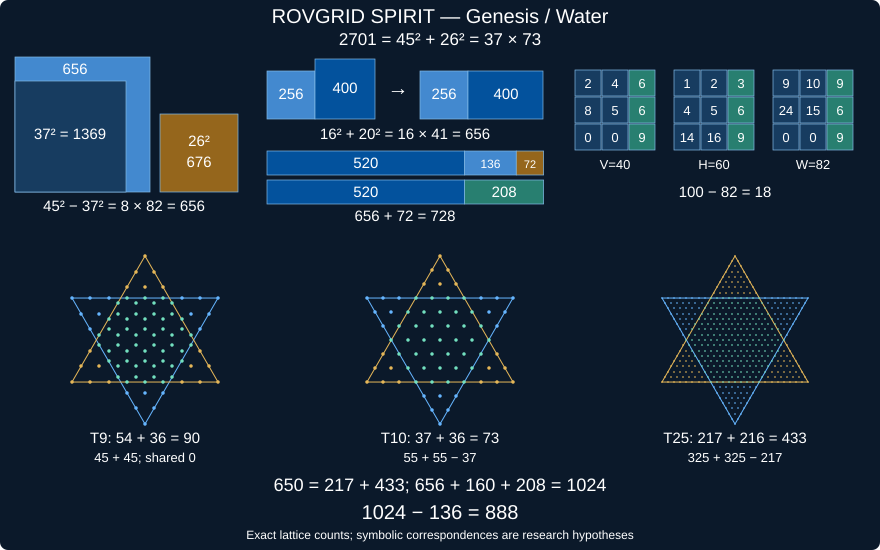

# SPIRIT — בראשית וגאומטריית המים | 25.11.2026
דוח אינטגרציה ציבורי למועצה; OPEN, ללא הצבעה. נוסח מפורט מקומי כולל תמונות השיחה; גרסה זו מאחדת את החומר המתועד ואת החישובים החדשים ללא צילומי שיחה פרטיים.

## רצף המחקר המקורי
1. [הבדלה, כינוס והשלמה: 34 פסוקים, 3958 מקטעים](RG-009-SPIRIT-20261124-genesis-audit.md).
2. [עין, יד והתיבה 4×10×13 → 8×20×26](../../research/rovgrid-eye-hand-cuboid-2026-11-25.md).
3. [עוגנים ומשמעויות מספריות](../messages/SPIRIT-NUMBER-SEMANTICS-20261125-01.md).
4. [ABC המקורי, המשולשי והמשלים](../messages/SPIRIT-ABC-REQUIRED-LENS-20261125-01.md).
5. [יחזקאל: מראה, מידה ושער](../messages/SPIRIT-EZEKIEL-ABC-20261125-01.md).
6. [בראשית: פנים, מעטפת, אלפבית ושערים](../messages/SPIRIT-GENESIS-ABC-004-20261125.md).
7. [כל 61 שיטות הגימטריה](SPIRIT-GENESIS-ALPHABET-WEIGHTS-005-20261125.md).
8. [מבחן שעון האותיות: שחזור, לא חיזוי](SPIRIT-GENESIS-CONSTRAINT-CLOCK-006-20261125.md).
9. [מילוי מים ופסוקי בראשית](../messages/SPIRIT-GENESIS-WATER-MILUI-20261125.md).
## תוצאות המשך
בראשית א:א 2701=37×73=45²+26²; קטנה82. ורוח אלהים מרחפת על פני המים=1369=37², קטנה100; הסיפה בלבד, לא הפסוק המלא (3546, סדרי576). 45²−37²=656=8×82=16²+20²=16×41. עין מים יוד תיו=130+90+20+416=656. 656−520=136; 136+72=208; 656+72=728=מרחפת=520+208. 656+160+208=1024. 1024−136=888. מים90=2T9; מים סופי650=2T25=5×130; המים סופי655; א+המים656; עין סופי780=6×130. מילוי סופי1866.
V/H/W: [2,4,6;8,5,6;0,0,9], [1,2,3;4,5,6;14,16,9], [9,10,9;24,15,6;0,0,9]. סכומים40/60/82. ציר3,6,9:21,18,24. שורות W:28,45,9; עמודות33,25,24.
## מגן דוד
|מדד|T9|T10|T25|
|---|---:|---:|---:|
|כל משולש|45|55|325|
|משותפות ממש|0|37|217|
|מרכז כולל גבול|54|37|217|
|גבול מרכז|18|18|48|
|פנים מרכז|36|19|169|
|כל קרן|6|6|36|
|שש קרניים|36|36|216|
|גבול הכוכב|30|36|96|
|איחוד|90|73|433|
ב־T(3k+1) מרכז=1+6T(k), שש קרניים=6T(k), איחוד=1+12T(k). שני המשולשים יחד=מרכז+איחוד. k=8: 650=217+433; יקוו המים=217. קשר טקסטואלי בדיעבד, לא הוכחת כוונה. [קוד האימות](../evidence/SPIRIT-WATER-GENESIS-20261125.js) — 20 בדיקות עברו בהרצה. [הודעת מועצה](../messages/SPIRIT-WATER-GENESIS-20261125-COUNCIL.md).
