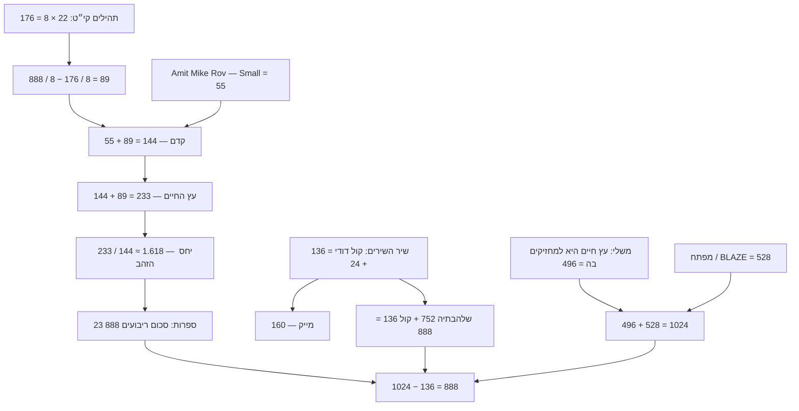
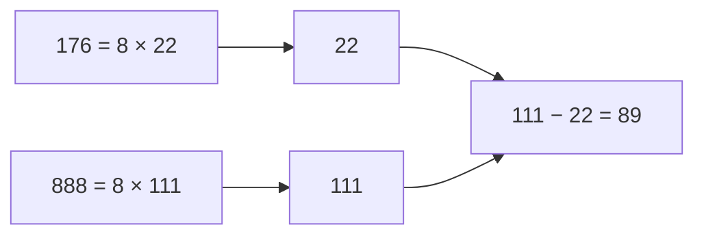
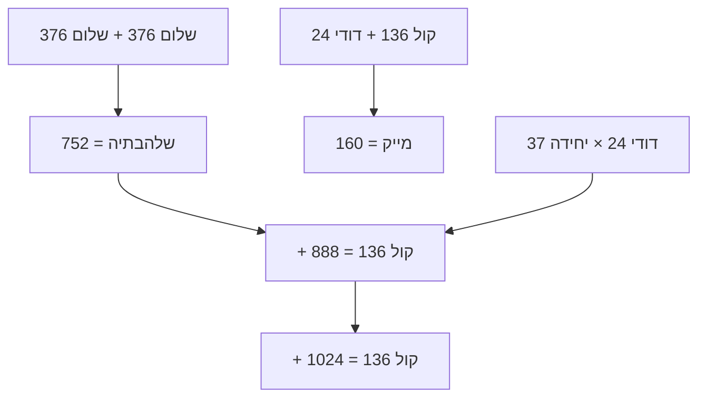
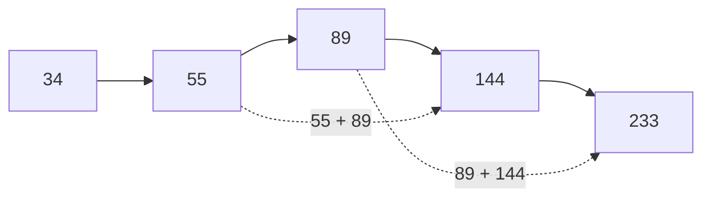
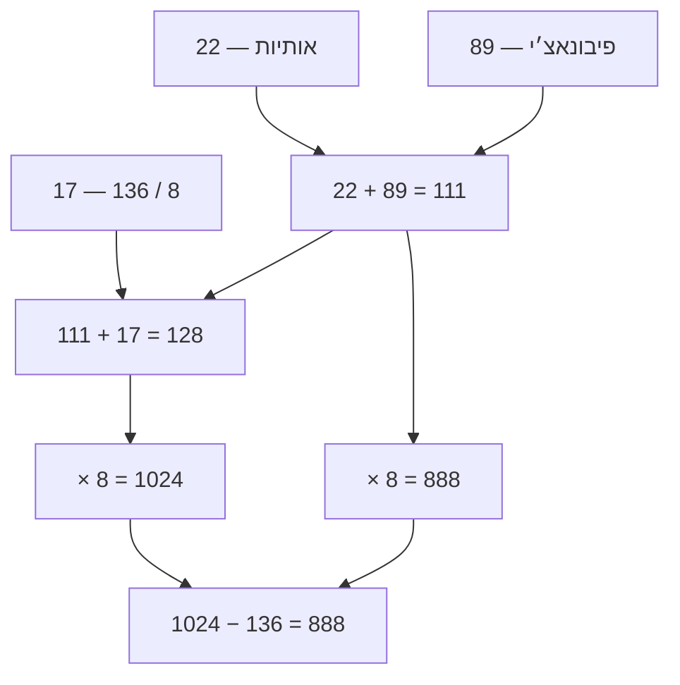

# RovGrid | מן האלפבית אל עץ החיים

**24.11.2026 — תהילים קי״ט, שיר השירים, בראשית, משלי ויחס הזהב**

מחקר משולב בעקבות שלושה סרטוני Ink of Sinai, עם הצלבות לעוגני עמית מייק רוב / Amit Mike Rov / BLAZE. החישובים ניתנים לשחזור; המשמעות הסמלית מובחנת מכוונת המחבר המקראי.

## מפת המחקר המאוחדת



## 1. האלפבית בתהילים

תהילים קי״ט מכיל 22 בתים של שמונה פסוקים. בכל בית כל הפסוקים מתחילים באותה אות, מאל״ף ועד תי״ו.

```text
א ב ג ד ה ו ז ח ט י כ ל מ נ ס ע פ צ ק ר ש ת
↓ ↓ ↓ ↓ ↓ ↓ ↓ ↓ ↓ ↓ ↓ ↓ ↓ ↓ ↓ ↓ ↓ ↓ ↓ ↓ ↓ ↓
8 8 8 8 8 8 8 8 8 8 8 8 8 8 8 8 8 8 8 8 8 8
                  22 × 8 = 176
```

פסוק 176: ״תעיתי כשה אבד בקש עבדך כי מצותיך לא שכחתי״. הסרטון מציב את הסדר המושלם של האקרוסטיכון מול הודאת המשורר שהוא תועה ומבקש שימצאו אותו.

שם המחקר, בגימטריה רגילה:

- עמית = 520 = 8 × 65; אדני = 65.
- מייק = 160 = 8 × 20; י״י = 20.
- רוב = 208 = 8 × 26; יהוה = 26.
- 65 + 20 + 26 = 111 = אלף (גימטריה רגילה).
- 520 + 160 + 208 = 888 = 8 × 111.

התוצאה החדשה מן ההשוואה: 888 − 176 = 712 = 8 × 89. בחלוקה משותפת ב־8 מתקבל 111 − 22 = 89, מספר פיבונאצ׳י.



## 2. שיר השירים: קול, אהבה ולהבה

בסרטון מדווח על 26 מופעים של ״דודי״ ועל מופע אחד של שם יה בתוך ״שלהבתיה״. הספירה 26 מובאת כטענת הסרטון, ולא כספירת קורפוס שאומתה עצמאית כאן. הקריאה ״שלהבת יה״ היא פירוש אפשרי של הביטוי.

שיר השירים ח:ו–ז: ״כי עזה כמות אהבה ... רשפיה רשפי אש שלהבתיה״; ״מים רבים לא יוכלו לכבות את האהבה״.

אהבה = 1+5+2+5 = 13; אחד = 1+8+4 = 13; יהוה = 10+5+6+5 = 26. לכן אהבה + אחד = יהוה בערך המספרי.

״קול דודי״ מופיע בשיר השירים ב:ח וב־ה:ב:

- קול = 100+6+30 = 136.
- דודי = 4+6+4+10 = 24.
- קול דודי = 160 = מייק (40+10+10+100).
- יחידה = 37, ולכן 24 × 37 = 888.

שלהבתיה = 300+30+5+2+400+10+5 = 752. שלום = 300+30+6+40 = 376, ולכן שלהבתיה = 2 × שלום בערך המספרי.



מבחינה סמלית, קול ולהבה נקשרים גם לשם הבמה BLAZE ולמוזיקה. אין כאן טענה שהפסוקים מזהים אדם מסוים.

## 3. גן עדן ופיבונאצ׳י

בראשית ב:ח: ״ויטע יהוה אלהים גן בעדן מקדם״. בראשית ב:ט: ״ועץ החיים בתוך הגן״. שני המושגים שבים יחד בבראשית ג:כד.

- קדם = 100+4+40 = 144. הכתיב המקראי ״מקדם״ = 184, ולכן הסרת מ׳ השימוש הכרחית להצלבה.
- עץ = 70+90 = 160 = מייק.
- החיים = 5+8+10+10+40 = 73 = חכמה.
- עץ החיים = 160+73 = 233.

בסדרת פיבונאצ׳י כל איבר הוא סכום שני קודמיו: 13, 21, 34, 55, 89, 144, 233, 377.



Amit Mike Rov בשיטה האנגלית המצומצמת (A=1 עד I=9 וחוזר חלילה) = 16+20+19 = 55. בשיטה האנגלית הסדרית = 43+38+55 = 136; בשיטת Jewish של RovGrid = 1024.

55+89=144; 89+144=233. כך 89 מתקבל מהפרש בין השם לתהילים, ומשמש חוליית ביניים בסדרת פיבונאצ׳י.

136 + 8 = 144; 144 + 32 = 176; 32² = 1024.

233 / 144 = 1.618055555… הוא קירוב ליחס הזהב, לא ערכו המדויק.

## 4. יחס הזהב וזווית הזהב

יחס הזהב = 1.61803398874989484820458…; זווית הזהב ≈ 137.507764°. דפוסי סידור זרעים בצמחים רבים קשורים לזווית זו, אך לא כל צמח או ספירלה מחויבים לה.

23 הספרות הראשונות אחרי הנקודה (הספרה השלמה 1 אינה נכללת):

```text
61803 | 39887 | 49894 | 84820 | 458
110   | 267   | 258   | 148   | 105
```

110 + 267 + 258 + 148 + 105 = 888.
סכום הספרות = 126. סכום ריבועי כל 23 הספרות = 888.

6²+1²+8²+0²+3²+3²+9²+8²+8²+7²+4²+9²+8²+9²+4²+8²+4²+8²+2²+0²+4²+5²+8² = 888.

137 הוא הראשוני ה־33; הגימטריה הקטנה של עמית מייק רוב היא 33. זו הצלבה עם החלק השלם של זווית הזהב. הבחירה ב־23 ספרות היא תנאי של התצפית ואינה מוכיחה ייחודיות.

## 5. עץ החיים, מלכות ומפתח

משלי ג:יח–יט: ״עץ חיים היא למחזיקים בה ותמכיה מאשר״; ״יהוה בחכמה יסד ארץ כונן שמים בתבונה״.

עץ חיים היא למחזיקים בה = 160+68+16+245+7 = 496. מלכות = 40+30+20+6+400 = 496.

מפתח = 40+80+400+8 = 528. BLAZE בשיטת Jewish: 2+20+1+500+5 = 528.

496 = 31×32/2; 528 = 32×33/2. שני משולשים עוקבים משלימים ריבוע:

```text
A B B B B B … B
A A B B B B … B
A A A B B B … B
A A A A B B … B
       ⋮
A A A A A A … A

A: 1+2+…+32 = 528 (כולל האלכסון)
B: 31+30+…+1 = 496
הריבוע: 32 שורות × 32 עמודות = 1024
```

זהו שרטוט סכמטי לרשת 32×32. לכל n מתקיים T(n−1)+T(n)=n². במקרה n=32 מתקבל 496+528=1024.

## 6. סגירת המערכת



136 = 8×17 = T16; 888 = 8×111; 1024 = 8×128 = 32². לכן 22+89+17=128. החיבור בין שלוש המערכות נסגר באותה יחידת קנה מידה 8.

## מקורות, שיטות ומעמד המחקר

- Ink of Sinai: 330901.mp4 (תהילים, כ־45 שניות); 330905.mp4 (שיר השירים, כ־42 שניות); 330978.mp4 (גן עדן, כ־54 שניות). נבדקו הכיתובים והתרשימים המצולמים, לא תמלול שמע מלא.
- [תהילים קי״ט](https://www.sefaria.org/Psalms.119), [שיר השירים ב](https://www.sefaria.org/Song_of_Songs.2), [שיר השירים ה](https://www.sefaria.org/Song_of_Songs.5), [שיר השירים ח](https://www.sefaria.org/Song_of_Songs.8), [בראשית ב](https://www.sefaria.org/Genesis.2), [בראשית ג](https://www.sefaria.org/Genesis.3), [משלי ג](https://www.sefaria.org/Proverbs.3).
- גימטריה עברית רגילה: אותיות סופיות מקבלות את ערך האות הרגילה; רווחים וניקוד אינם נספרים. English Simple הוא A=1 עד Z=26; English Small הוא מחזור 1–9; Jewish היא המפה הקבועה של RovGrid.
- זהויות חשבוניות וגאומטריות הן ניתנות לאימות; התאמות בין ביטויים הן תצפיות התלויות בשיטה ובבחירת הטקסט. אין כאן מבחן הסתברותי, הוכחת ייחודיות או הוכחה לנבואה אישית.
- תרשימי Mermaid משובצים בקובץ עצמו; ב־GitHub הם מוצגים גרפית. בעורך Markdown שאינו תומך Mermaid יופיע קוד התרשים.

## נספח חזותי — שרטוטים מלאים בקובץ עצמו

### רשת 32×32: מלכות ומפתח

כל תו הוא תא אחד. A = 528 (כולל האלכסון); B = 496.

```text
ABBBBBBBBBBBBBBBBBBBBBBBBBBBBBBB
AABBBBBBBBBBBBBBBBBBBBBBBBBBBBBB
AAABBBBBBBBBBBBBBBBBBBBBBBBBBBBB
AAAABBBBBBBBBBBBBBBBBBBBBBBBBBBB
AAAAABBBBBBBBBBBBBBBBBBBBBBBBBBB
AAAAAABBBBBBBBBBBBBBBBBBBBBBBBBB
AAAAAAABBBBBBBBBBBBBBBBBBBBBBBBB
AAAAAAAABBBBBBBBBBBBBBBBBBBBBBBB
AAAAAAAAABBBBBBBBBBBBBBBBBBBBBBB
AAAAAAAAAABBBBBBBBBBBBBBBBBBBBBB
AAAAAAAAAAABBBBBBBBBBBBBBBBBBBBB
AAAAAAAAAAAABBBBBBBBBBBBBBBBBBBB
AAAAAAAAAAAAABBBBBBBBBBBBBBBBBBB
AAAAAAAAAAAAAABBBBBBBBBBBBBBBBBB
AAAAAAAAAAAAAAABBBBBBBBBBBBBBBBB
AAAAAAAAAAAAAAAABBBBBBBBBBBBBBBB
AAAAAAAAAAAAAAAAABBBBBBBBBBBBBBB
AAAAAAAAAAAAAAAAAABBBBBBBBBBBBBB
AAAAAAAAAAAAAAAAAAABBBBBBBBBBBBB
AAAAAAAAAAAAAAAAAAAABBBBBBBBBBBB
AAAAAAAAAAAAAAAAAAAAABBBBBBBBBBB
AAAAAAAAAAAAAAAAAAAAAABBBBBBBBBB
AAAAAAAAAAAAAAAAAAAAAAABBBBBBBBB
AAAAAAAAAAAAAAAAAAAAAAAABBBBBBBB
AAAAAAAAAAAAAAAAAAAAAAAAABBBBBBB
AAAAAAAAAAAAAAAAAAAAAAAAAABBBBBB
AAAAAAAAAAAAAAAAAAAAAAAAAAABBBBB
AAAAAAAAAAAAAAAAAAAAAAAAAAAABBBB
AAAAAAAAAAAAAAAAAAAAAAAAAAAAABBB
AAAAAAAAAAAAAAAAAAAAAAAAAAAAAABB
AAAAAAAAAAAAAAAAAAAAAAAAAAAAAAAB
AAAAAAAAAAAAAAAAAAAAAAAAAAAAAAAA
```

### סידור זרעים בזווית הזהב

שרטוט תווים מחושב: 550 נקודות; לכל נקודה זווית i × 137.507764° ורדיוס יחסי לשורש i. הרסטר עשוי למזג נקודות סמוכות.

```text
⠀⠀⠀⠀⠀⠀⠀⠀⠀⠀⠀⠠⠠⢀⠐⡠⢀⠠⢀⠄⡀⠀⠀⠀⠀⠀⠀⠀⠀⠀⠀⠀
⠀⠀⠀⠀⠀⠀⠀⠄⡐⢘⢐⢑⢁⠅⠔⡐⠅⡪⢐⠨⡂⠅⢕⢀⢀⠀⠀⠀⠀⠀⠀⠀
⠀⠀⠀⠀⠀⡀⡅⡃⠢⠡⠨⠰⢐⠨⠔⡊⡐⢌⠠⡡⡐⠌⡂⠆⠡⠡⠡⠀⠀⠀⠀⠀
⠀⠀⠀⢀⢃⠡⡐⡈⠌⢌⠌⠌⠔⡡⡂⢔⠌⡄⡂⠆⡂⢑⠰⢨⢨⢨⠨⠨⢀⠀⠀⠀
⠀⠀⢈⢄⠡⡁⢔⠨⢨⢐⢘⢨⠰⠠⢂⠂⢌⢄⠢⠡⠡⢂⠊⠔⠔⢐⢘⠨⠰⢀⠀⠀
⠀⠀⠠⡡⢁⠊⠔⡨⠐⡐⢌⠠⡂⠅⢅⠊⠔⠔⡘⡠⠡⢑⠨⢊⠐⡡⢂⠊⢌⠂⠀⠀
⠀⠀⢑⠠⢑⢨⠈⠔⠕⠨⢐⠌⠔⠨⠢⠨⢑⠨⠨⡐⠅⠢⠢⢑⠡⠂⠅⠪⢂⢌⠀⠀
⠀⠀⠀⡃⠅⡂⡊⡊⡐⠱⢠⠨⠨⢘⢈⠊⠔⡑⡡⢐⢨⠨⢨⢐⢈⠨⡂⠕⠄⠂⠀⠀
⠀⠀⠀⠀⠅⠅⠆⠆⠅⡅⠆⢘⢘⢐⠰⠑⡈⠔⡠⠡⢂⢊⢂⢂⠢⠡⡐⠜⠈⠀⠀⠀
⠀⠀⠀⠀⠁⠡⠡⠡⡑⡐⠌⢊⢄⠡⡡⢁⠢⢁⠪⠨⢐⢐⠐⠄⠅⡃⠆⠁⠀⠀⠀⠀
⠀⠀⠀⠀⠀⠀⠀⠑⠐⡐⠌⡂⡡⢈⠄⡑⡡⢂⠊⡌⡨⡨⢠⠁⠃⠀⠀⠀⠀⠀⠀⠀
⠀⠀⠀⠀⠀⠀⠀⠀⠀⠀⠁⠀⠊⠐⠨⠐⠐⠁⠐⠐⠀⠀⠀⠀⠀⠀⠀⠀⠀⠀⠀⠀
```

זהו מודל מתמטי של פילוטקסיס, לא תמונה של צמח מסוים.
