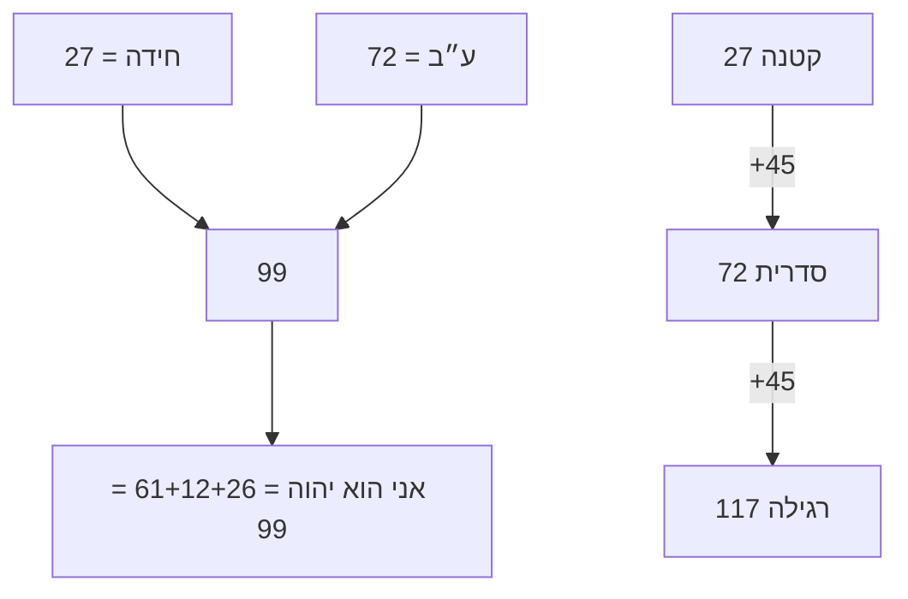
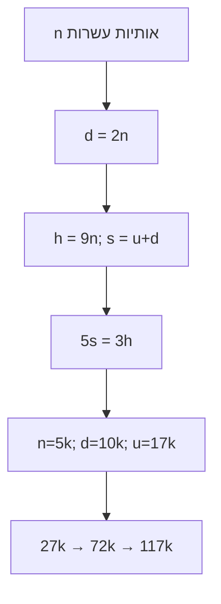
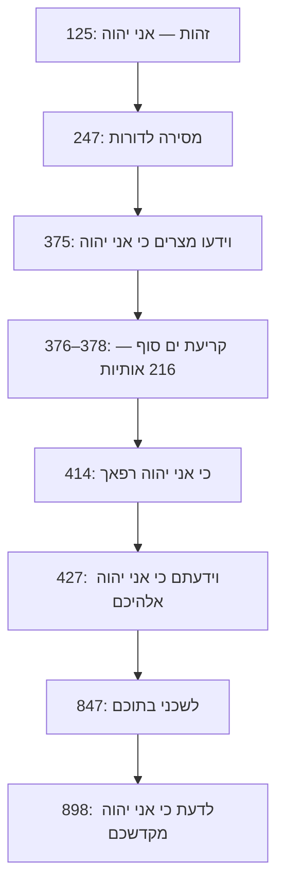
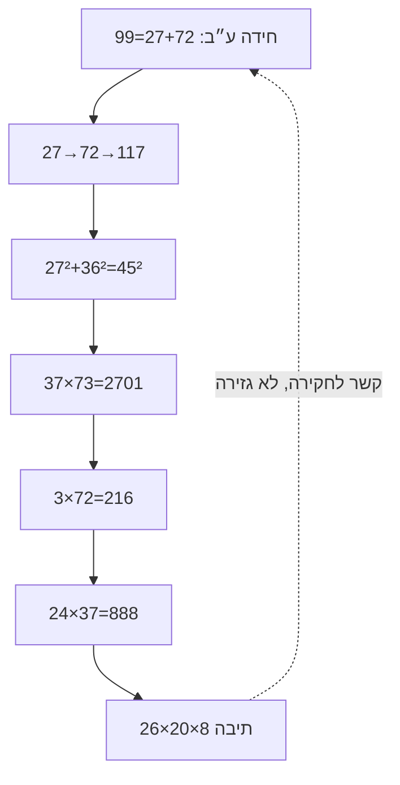

# ROVGRID — מחולל ע״ב | אני יהוה | חידה ע״ב
27.11.2026 | RG-ANI-YHWH-72 | תיק הכרעה וראיות v1

מסמך מאוחד של ההמחשה הקודמת ושל הבדיקות החדשות. הגרסה הציבורית משמיטה שמות פרטיים וקישורים לזהות אישית בהתאם לפרוטוקול. התרשימים הומרו ל-Mermaid ולטקסט קבוע, כדי שיופיעו בתוך Markdown ולא יהיו תלויים בצ׳אט. מקור הנתונים ההיסטוריים: הסריקה שהוצגה בשיחה; חישובי האותיות והחלון המרכזי חושבו מחדש מהפסוקים המלאים שלהלן. סריקת כל התנ״ך לא הורצה מחדש. אין כאן הצבעה בשם חוקרים אחרים.

## 1. פסק הכרעה
| טענה | הכרעה לפי הראיה |
|---|---|
| 27–72–117 והפרש 45 | מוכח חשבונית |
| 27²+36²=45² | מוכח |
| מחולל כללי למשפחת החתימות הפיתגוראיות | מוכח אלגברית בסייג המוגדר בסעיף 3 |
| 37,73,137 והפרשי ריבועים | מוכח |
| ע״ב: 3×72, היפוך השורה השנייה | שוחזר מהטקסט |
| 888 בחלון 25–48 באלב״ם סדרית | שוחזר; היסט 11 יחיד בין 22 היסטים בחלון זה |
| ייחודיות בכל החלונות ובכל השיטות | טרם אומתה מחדש |
| תשעה מחזורי מיקום קבועים | נדחו ביחס לאינדקסים המדווחים |
| זהות–פעולה–ידיעה | תיאור ספרותי הנתמך בדוגמאות; לא מחולל מספרי |
| גזירת מיקומי הפסוקים, ספר שמות או כלל התנ״ך | לא הוכחה |
| מקור היסטורי משותף בן 28 סימנים | השערת מודל בלבד |

הכרעה מחקרית אינה זהה לנעילה פורמלית של המועצה. לפי council/PROTOCOL.md נדרשות שלוש הצבעות YES בלתי תלויות על אותה מסקנה וגרסה, ותיעוד WORK. אין להציג התאמות חשבוניות כהוכחה לכוונת מחבר או לזהות אישית.

## 2. שער החידה וההכרה

חידה ע״ב: צמצום מילים 18, קטנה 27, סדרית 45, רגילה 99, קדמית 444 (סכום הערכים המצטברים לכל אות).

| ביטוי | קטנה | סדרית | רגילה |
|---|---:|---:|---:|
| כי | 3 | 21 | 30 |
| אני | 7 | 25 | 61 |
| יהוה | 17 | 26 | 26 |
| אני יהוה | 24 | 51 | 87 |
| כי אני יהוה | 27 | 72 | 117 |

27+117=144=2×72. 18+27=45.

```text
           27          72          117
        [קטנה] ──45── [סדרית] ──45── [רגילה]

        ●
        │╲
     27 │ ╲ 45
        │  ╲
        └───●
          36
```
27²+36²=45²; 729+1296=2025; 36=72/2. 9×(3,4,5).
27,72,117 = 9×(3,8,13).

## 3. הכרעה חדשה: מחולל אלגברי של כל המשפחה
```text
             כי אני יהוה
    ┌────────────────────────────┐
    │ עשרות: כ י נ י י           │
    │ ספרות: 2+1+5+1+1 = 10     │
    ├────────────────────────────┤
    │ יחידות: א ה ו ה            │
    │ 1+5+6+5 = 17              │
    └────────────────────────────┘
```
| משפחה | קטנה | סדרית | רגילה |
|---|---:|---:|---:|
| יחידות | 17 | 17 | 17 |
| עשרות | 10 | 55 | 100 |
| סך הכל | 27 | 72 | 117 |

עבור ביטוי המורכב מאותיות יחידות ועשרות בלבד (א–צ, ללא ק–ת), נגדיר n כמספר אותיות העשרות, d כסכום ספרותיהן, u כסכום היחידות. סופיות מנורמלות לצורתן הרגילה.

קטנה s=u+d; סדרית=s+9n; רגילה=u+10d.
שני ההפרשים הם 9n ו-9(d−n). הם שווים אם ורק אם d=2n.
נסמן h=9n. אם דורשים בנוסף את המשולש המסוים: s²+((s+h)/2)²=h².
כפל ב-4 וסידור: 5s²+2sh−3h²=0.
פירוק: (5s−3h)(s+h)=0.
במקרה חיובי s+h>0 ולכן 5s=3h. מכאן s=27n/5, n כפולה של 5.
לכן n=5k, d=10k, u=17k, ומתקבלת בהכרח החתימה (27k,72k,117k).
גם הכיוון ההפוך נכון בהצבה. k מספר שלם חיובי. עבור k=1 הביטוי המקראי הוא דוגמה מדויקת. זו משפחת מחוללים לחשבון האותיות, לא הוכחת ייחודיות מילולית או מחולל פסוקים.



## 4. שער 27,37,72,73,137
```text
    27 ─────── 73      27+73=100
    │           │
   +10         −1
    │           │
    37 ─────── 72
    37 ──36── 73 ──64── 137
    └──────────100────────┘
```
27×37=999; 37×73=2701; 73×137=10001; 27+37+73=137; 37+73=110; 73−37=36.
37 הוא ראשוני 12; 73 ראשוני 21; 137 ראשוני 33; 12+21=33.
73−37=6²; 137−73=8²; 137−37=10². 6²+8²=10².
הפרשי המספרים הם ריבועי אורכי הניצבים והיתר, לא אורכי הצלעות עצמם.

## 5. שער בראשית
בראשית ברא אלהים את השמים ואת הארץ.
2701 = 37×73 = T73, כאשר Tn=n(n+1)/2.
```text
                    /╲
                   /  ╲
                  /666 ╲      T36
                 /──────╲
                /╲ 703  /╲    T37 במרכז
               /666╲  /666╲
              /─────╲/─────╲
```
התרשים סכמטי; הספירה המדויקת לפי הזהות T(2n+1)=3T(n)+T(n+1) עבור n=36.
3×666+703=2701; 45²+26²=2701; 27²+27×73+1=2701; 3×888+37=2701.
בראשית אלהים=999; ברא את השמים=999; ואת הארץ=703.
28 אותיות + 82 בגימטריה קטנה = 110 = 37+73.

## 6. שער האלפבית המשולש — מודל מוצע
```text
                    ●
                  ●   ●
                ●   ●   ●
              ●   ●   ●   ●
            ●   ●   ●   ●   ●
          ●   ●   ●   ●   ●   ●
        ●   ○   ○   ○   ○   ○   α
                  T7 = 28
             22 + 5 + α
```
28→27→26→24→22: מודל גריעה מוצע, לא תולדות האלפבית.
22 עברית + 24 יוונית קלאסית + 26 אנגלית = 72.
27+28=55; 72+55=127; 127+9=136; 1024−136=888.
F(x,α)=(1+x)⁵(1+αx); עבור α=1 מתקבלת שורת פסקל 1,6,15,20,15,6,1.
```text
                 1
                1 1
               1 2 1
              1 3 3 1
             1 4 6 4 1
           1 5 10 10 5 1
          1 6 15 20 15 6 1
```
2³=8 אפשרויות בשלוש בחירות בינאריות; 2⁶=64 בשש בחירות. אין כאן הוכחה שהאלפביתים נגזרו כך בפועל.

## 7. שער קריעת ים סוף — הטקסט המלא
שמות י״ד י״ט (אינדקס מדווח 376):
ויסע מלאך האלהים ההלך לפני מחנה ישראל וילך מאחריהם ויסע עמוד הענן מפניהם ויעמד מאחריהם

שמות י״ד כ׳ (377):
ויבא בין מחנה מצרים ובין מחנה ישראל ויהי הענן והחשך ויאר את הלילה ולא קרב זה אל זה כל הלילה

שמות י״ד כ״א (378):
ויט משה את ידו על הים ויולך יהוה את הים ברוח קדים עזה כל הלילה וישם את הים לחרבה ויבקעו המים

```text
      1                 36|37                72
א     ──────────────────→─────────────────────   2672
ב     ──────────────────←─────────────────────   3043
ג     ──────────────────→─────────────────────   3428
      │ │ │ │ │ │ │ │ │ │ │ │ │ │ │ │ │ │ │
                 72 שמות × 3
```
כל שורה בת 72 אותיות; סך 216 אותיות, 56 מילים. גימטריה רגילה 2672+3043+3428=9143.
אינדקסי התורה 1909–1911, מילים 26136–26191, אותיות 99060–99275: נתונים מדווחים, לא חושבו מחדש ממלוא התורה.
שוחזרו 69 צירופים שונים מתוך 72 (3 מופעים מעבר לייחודיים). 7 מופעים פלינדרומיים: והו, ילי, אכא, ייי, ההה, והו, מומ.

## 8. ציר ההיפוך
```text
  1          24 25        36 | 37        48 49          72
  └──────────────────────────────────────────────────────┘
              └──────────────────────────┘
                           └─┘
```
f(i)=73−i; f(f(i))=i.
1↔72, 25↔48, 36↔37, 24↔49. החלון 25–48 נשמר תחת ההיפוך.
שם 37 אני=61; שם 49 והו=17; 49−37=36−24=12.
היפוך האינדקסים אינו מבטיח שהערכים של כל שני שמות יהיו זהים.

## 9. החלון המרכזי — 888
```text
              25                  48
   שורה א     [■■■■■■■■■■■■■■■■■■■■■■■■] 268
   שורה ב     [■■■■■■■■■■■■■■■■■■■■■■■■] 321
   שורה ג     [■■■■■■■■■■■■■■■■■■■■■■■■] 299
                    72 אותיות           888
```
אלב״ם סדרית בלבד: מזיזים כל אות 11 מקומות במחזור בן 22 ומסכמים את מיקומה החדש (1–22).
268+321+299=888=24×37. 888/24=37.
בדיקת כל ההיסטים 0–21 בחלון זה (בסדר עולה):
756, 784, 790, 752, 802, 874, 946, 930, 980, 986, 948, **888**, 894, 724, 796, 802, 852, 792, 644, 694, 766, 816.
הכרעה: 11 הוא ההיסט היחיד שנותן 888 בחלון 25–48 בסכום סדרי. באלב״ם רגילה מתקבל 6522, לא 888.
2628 חלונות רציפים = 72×73/2. דווח בעבר על 48 מסלולים, 126144 בדיקות ו-36 התאמות 888; לא שוחזרו הגדרות המסלולים ולכן המספרים האחרונים אינם מוכרעים.
תעתיק אנגלי מדווח: 598+555+616=1769; 1769+21−14=1776; 1769−18+25=1776; 1776=2×888. החשבון נכון; מיפוי התעתיק עצמו והייחודיות אינם מוכחים.

## 10. התיבה והפולינום
```text
          +────────────+ 
         /   208      /│
        +────────────+ │
        │            │ │
     20 │    520     │160  8
        │            │ /
        +────────────+/
              26
```
8+20+26=54; 8×20=160; 8×26=208; 20×26=520.
160+208+520=888; שטח פני התיבה המלא 1776; נפח 4160.
P(x)=(x−8)(x−20)(x−26)=x³−54x²+888x−4160.
54×4=216=72×3; 216+288=504=72×7; 296×3=888; 10+15+21+26=72.
הקשרים חשבוניים; אין הוכחה שהתיבה מחוללת את פסוקי ע״ב.

## 11. שערי ספר שמות
```text
125 ───125─── 250 ───125─── 375 ──→ 376 377 378
מופע          אין מופע       מופע    שלושת פסוקי ע״ב
```
125=5³; 375=3×125. 250 אינו מופע. שלושת האינדקסים 125,250,375 אינם רצף של שלושה מופעים.
| מופע | פסוק | אינדקס | מרחק |
|---:|---|---:|---:|
|1|ו׳ ב׳|125|—|
|2|ו׳ ו׳|129|4|
|3|ו׳ ז׳|130|1|
|4|ו׳ ח׳|131|1|
|5|ו׳ כ״ט|152|21|
|6|ז׳ ה׳|158|6|
|7|ז׳ י״ז|170|12|
|8|ח׳ י״ח|200|30|
|9|י׳ ב׳|247|47|
|10|י״ב י״ב|296|49|
|11|י״ד ד׳|361|65|
|12|י״ד י״ח|375|14|
|13|ט״ו כ״ו|414|39|
|14|ט״ז י״ב|427|13|
|15|כ״ט מ״ו|847|420|
|16|ל״א י״ג|898|51|

17 מופעים ב-16 פסוקים; 11 של כי אני יהוה; כפילות בפסוק 847. האינדקסים לפי הסריקה שסופקה.
```text
 0       125–131 152 158 170 200 247 296 361 375 414 427          847 898
 |────────████────█──█──█──█──█───█───█──◆───█──█────────────────█──█
```

## 12. מבחן חיזוי
נקודת מוצא 375; ארבעת הפרשי האינדקסים המאוחרים הם 39,52,472,523.
| מחזור | תחזיות | פגיעות |
|---:|---:|---:|
|27|30|0|
|36|23|0|
|37|22|0|
|45|18|0|
|72|11|0|
|73|11|0|
|117|7|0|
|125|6|0|
|250|3|0|
|סך|131|0|

```text
 27  ██████████████████████████████ 30 |0
 36  ███████████████████████        23 |0
 37  ██████████████████████         22 |0
 45  ██████████████████             18 |0
 72  ███████████                    11 |0
 73  ███████████                    11 |0
117  ███████                         7 |0
125  ██████                          6 |0
250  ███                             3 |0
```
131 תחזיות כוללות כפילויות בין מסלולים; אין לטעון ל-131 פסוקים ייחודיים.
הכרעה: לפי האינדקסים הנתונים אף מחזור לא מחלק אף אחד מארבעת ההפרשים. מחזור קבוע לכל המופעים גם נשלל על ידי שני מרווחים בני 1. זה אינו שולל מחולל לא־ליניארי שטרם הוגדר.

## 13. מנגנון ההכרה

זהות → פעולה → ידיעה: שחרור, רפואה, הזנה, שכינה, קדושה. זו תבנית ספרותית בפרקים שנבחרו; לא סיווג מלא של כלל המופעים.

## 14. סריקת התנ״ך
23,206 פסוקים ב-39 יחידות דיגיטליות של ספריא (לפי הסריקה המדווחת).
| ספר | אני יהוה (כולל כי) | כי אני יהוה |
|---|---:|---:|
|יחזקאל|86|70|
|ויקרא|52|10|
|ישעיהו|22|7|
|שמות|17|11|
|במדבר|8|1|
|יתר|14|8|
|סך|199|107|

```text
יחזקאל    ████████████████████████████████░░░░░░░ 86/70
ויקרא      █████░░░░░░░░░░░░░░░░░░░░             52/10
ישעיהו     ███░░░░░░░                            22/7
שמות       █████░░░                              17/11
במדבר      █░░░                                   8/1
יתר        ████░░░                               14/8
█ כי אני יהוה; ░ יתר המופעים; אורך מקורב בלבד.
```
יחזקאל: 70+5+1=76 (5 כי אני אדני יהוה, 1 אשר אני יהוה בהקשר של ידיעה). דווח על 72–77 נוסחאות הכרה במחקר לפי ההגדרה; מקור אקדמי מלא לא נמסר, יש לאתרו לפני קבלת הטענה.
199 ו-107 הם סכומי השורות, לא ספירה עצמאית מחדש. מופע מילולי אינו בהכרח הכרזה אלוהית.

## 15. מבנה מאוחד

החיצים בין המשפחות מציינים קשרי מחקר בלבד, לא הוכחת גזירה. המחולל הפיתגוראי הלשוני נפתר בסעיף 3; מחולל המיקום לא נפתר.

## 16. קוד שחזור עצמאי (Python 3)
```python
import re
a='אבגדהוזחטיכלמנסעפצקרשת'
tr=str.maketrans('ךםןףץ','כמנפצ')
v=dict(zip(a,[*range(1,10),*range(10,100,10),100,200,300,400]))
verses=[
'ויסע מלאך האלהים ההלך לפני מחנה ישראל וילך מאחריהם ויסע עמוד הענן מפניהם ויעמד מאחריהם',
'ויבא בין מחנה מצרים ובין מחנה ישראל ויהי הענן והחשך ויאר את הלילה ולא קרב זה אל זה כל הלילה',
'ויט משה את ידו על הים ויולך יהוה את הים ברוח קדים עזה כל הלילה וישם את הים לחרבה ויבקעו המים']
r=[''.join(re.findall('[א-ת]',s)).translate(tr) for s in verses]
assert [len(s) for s in r]==[72,72,72]
assert [sum(v[c] for c in s) for s in r]==[2672,3043,3428]
assert sum(len(s.split()) for s in verses)==56
r[1]=r[1][::-1]
names=[''.join(t) for t in zip(*r)]
assert len(set(names))==69 and sum(s==s[::-1] for s in names)==7
assert names[36]=='אני' and names[48]=='והו'
def shift(s,k):
    return sum((a.index(c)+k)%22+1 for c in s)
assert [shift(s[24:48],11) for s in r]==[268,321,299]
values=[sum(shift(s[24:48],k) for s in r) for k in range(22)]
assert [k for k,x in enumerate(values) if x==888]==[11]
gaps=[39,52,472,523]
cycles=[27,36,37,45,72,73,117,125,250]
assert all(g%c for c in cycles for g in gaps)
assert 27**2+36**2==45**2
assert 37*73==2701 and 73*137==10001
print(values)
print(' '.join(names))
```

## 17. בקשת הכרעה עצמאית
MATTER: שחזור סעיפים 3, 7–9, 12; להציג חישוב, הוכחה נגדית אם נמצאה, והבחנה בין ייחודיות מקומית לכוללת.
MIRROR: לבדוק את כל החלונות וההיסטים, לתעד הגדרת שיטה, כפילויות ומספר בדיקות.
SPIRIT: לאמת נוסחת ההכרה במקורות, פירוש ומגבלות.
ARCHIVIST: מקור מסורה, גרסת מאגר, סקר 199/107 ופרטי הספרות האקדמית; להפריד ממצאים מדווחים משוחזרים.
WORK/JUDGE: לקבל את הראיות, להכריע בכל טענה בנפרד, לבקש תיקון אם חסר מקור. אין להכריז על LOCKED לפני שלוש הצבעות לפי הפרוטוקול. השאלה הפתוחה: מחולל מוגדר מראש שמנבא אינדקסים בנתוני מבחן שלא שימשו לבנייה.
