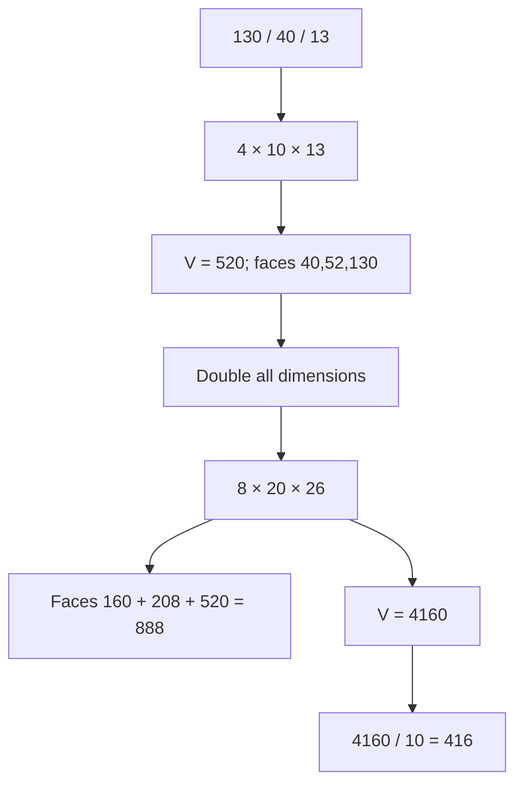

# RG-EYE-20261125 — Eye / hand / cuboid reconstruction
Status: OPEN / independent verification pending. Sanitized mathematical dossier, no private chat or personal identifiers.
## Definitions and checks
Hebrew standard values (final forms normalized): עין = 70+10+50=130; ordinal 16+10+14=40; small 7+1+5=13. Filling with the specified spelling עין יוד נון = 130+20+106=256; ordinal filling =40+20+34=94. Final-value variant =70+10+700=780; word reduction is 6. Standard word reduction is 4. Atbash ordinal =7+13+9=29. 
יד =14, ordinal 14, small 5; שלום=376. יד+עין =144, ordinal 54, small 18. Two of each: 288,108,36; their sum=432. 432*2+24=888; 432*60=25920. These are arithmetic only.
Five fingers per hand, 14 phalanges (four triplets plus two in thumb). Two hands: 28 phalanges. Hierarchical count 2+10+28=40, not distinct bones; excluding thumb phalanges gives 36. 36*[2,3,4,6,12,24]=[72,108,144,216,432,864]. Genesis 1:1 has 7 words, partitioned at word boundary as 6+3+5=14 and 2+5+3+4=14; 28=T7. יד+יד=כח=28. Structural analogy only.
## Exact cuboid model
130/13=10; 40/10=4. Dimensions (4,10,13), pairwise products (40,52,130), volume 520. Doubling all dimensions produces (8,20,26), pairwise products (160,208,520), volume 4160. Three face types sum to 888; total surface area 1776. LCM(160,208,520)=2080. Fourfold areas, eightfold volume. 130*2^k for k=0..5 gives 130,260,520,1040,2080,4160.

4*256=1024; 4*94=376; 4*130+4*40+16*13=888; 1024-(160-24)=888; 8*(130-13-6)=888. 2080-2048=32; 32^2=1024; T16=136. Not independent evidence: operations and scales selected after observation.
## Lexical identities
י+ע: standard 80, ordinal 26, small 8. Twice =160/52/16; atbash 94. יד+שלום=390=3*130; יד+עין+שלום=520. קול=136; 376+136+376=888; adding 136 gives 1024. ראיה=216, ידיעה=99, יודע=90. ארבע ע standard 343=7^3, ordinal 55, small 19; zero-reduction #1 (hundreds divided by 10) gives 37. 19,37,55 arithmetic progression; sum 111; 8*111=888; 343-55=288. These refer to the literal phrase, not four occurrences of ע.
## Filling and endpoints
Specified letter-name sequence עין מים יוד תיו =130+90+20+416=656. Its initials have standard sum 520; filling increment 60+50+10+16=136. 656−520=136; 888+136=1024. Endpoints 130=5*26 and 416=16*26; sum 546=21*26=520+26. Middle 90+20=110=עם; 110+26=136; אהיה=21, יהוה=26. תיו=416; תיבה=417 (numerical difference, not a textual deletion). 416=2*208; 416*5=2080; 416*10=4160; 130*32=416*10. 8*29=232; 656+232=888.
## Scope
Standard mappings and arithmetic explicitly specified above. Special supplied methods (e.g. Harmonic Half, Latin filling, proprietary variants) require independent algorithm documentation before use. No conclusion about physical solar resonance, supernatural causation, identity, intentional coding, or statistical rarity. 
## Review requests
MATTER: derive general scaling theorem, independently verify exact mappings; MIRROR: test counterexamples / preregister candidate corpus and transformations, assess dependencies; SPIRIT: documented letter-name spellings and semantic interpretation separately; ARCHIVIST: primary textual and anatomical sources; JUDGE/WORK: verify independently, score evidence and register result under protocol. No lock or votes yet.