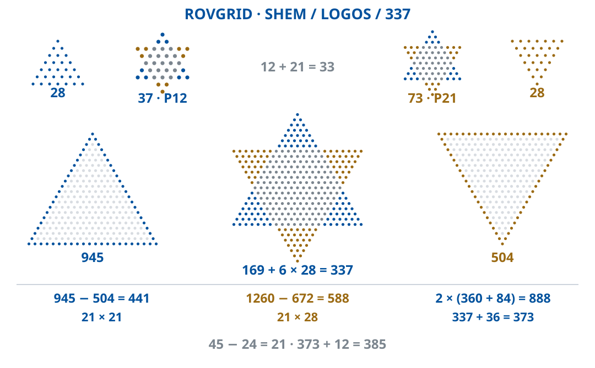

# שם — הרבה יותר ממה שאנשים חושבים
## ROVGRID / MATTER · 2026-11-28 · dossier RG-SHEM-LOGOS-337

Scope: the current conversation's full numerical and geometric research; prior twin-cuboid result as referenced. Hebrew publication narrative, reproducible model, data and research handoff. Thai comparison removed at user's request. Exact mathematical identities are distinguished from symbolic interpretations. No historical or supernatural causation is inferred.

## 1. יום ולילה
אני יום = 117 = כי אני יהוה; אני לילה = 136 = קול. אני יום אני לילה: 13 letters, regular 253=T22. 
| Method | אני | יום | לילה | אני יום | אני לילה | full |
|---|---:|---:|---:|---:|---:|---:|
| Regular |61|56|75|117|136|253|
| Ordinal |25|29|39|54|64|118|
| Small |7|11|12|18|19|37|
| Standard ordinal filling |84|68|84|152|168|320|
| Atbash ordinal |44|40|53|84|97|181|
| Albam ordinal |36|40|39|76|75|151|
| Composite |33|29|53|62|86|148|

253−181=72; 320−253=67=בינה; 181−148=151−118=33; 118+181=151+148=299=13×23; 148=4×37; 118=2×59. 136−117=19, small אני לילה. 320=4480−4160 (twin cuboids 8×20×26,10×16×28, common surface 1776; see previous MATTER inverse reconstruction report). Filling convention יוד, ויו, תיו; אני and לילה both 84.

## 2. Exact geometry and general theorem
Let k≥1 integer, n=3k+1, and x+y+z=0 on triangular lattice, all integers. Up triangle max(x,y,z)≤k, down triangle min(x,y,z)≥−k. Each contains T(n)=n(n+1)/2 points; intersection is hexagonal H=3k(k+1)+1, each of six wings T(k)=k(k+1)/2. Union S=6k(k+1)+1. For k=2: T7=28, H19, S37. k=3: T10=55, H37, S73. k=5: T16=136, H91, S181. k=7: T22=253, H169, S337, wings 28 each, total 168. 37 and 73 are primes 12 and 21; 12+21=33. 337 prime 68, reverse 733 prime 130 but not star. Numeric H37 equals S37, not identical shapes. כח=28; הכל=55. כח עליון / כח תחתון are symbolic labels for the two primitive 28 triangles, not regular gematria of the full phrases (194,892). 169=13²=אחד×אחד=הכל כח אלהים. 337 and 733 contain digit substrings 33,37,73.

Row label convention: on upward triangle apex א, base ת; on downward triangle apex ת, base א. Repeat the row letter on every point. Mirror via 180° rotation and Atbash. Let a,b,c≥0, a+b+c=n−1; cyclic rotation permutes coordinates. Up ordinal n−a, mirrored ordinal 1+a. Each nonfixed 3-orbit has up sum 2n+1, down n+2, difference n−1. Only fixed point has a=b=c=k and lies in center, not perimeter/wings.
Perimeter 3(n−1) points → n−1 orbits → Δ perimeter=(n−1)². Three wings 3T(k) points → T(k) orbits → Δ wings=(n−1)T(k). At n=22, 45−24=21=אהיה, 21 perimeter orbits and 28 wing orbits. 945−504=441=אמת=אהיה×אהיה; 1260−672=588=21×כח. 441+588=1029=3×7³. כח אהיה אמת=490=10×7². Wings individual (up) 140,560,560; (down) 504,84,84.
Symbolic numerical combination (not dimensionally homogeneous): exterior angles 3×120°=360° each; three wings 3×28=84; 360+84=444 twice; 444+444=888; 120+28=148, 6×148=888, and 148 is composite ordinal of אני יום אני לילה.

## 3. Hexagon, diagonals, envelopes
15 rows of lengths 8,9,...,15,...,9,8. Up row letter ordinal y+15 (8..22), down y+8 (1..15), y from −7 to 7. Each shared point difference 7. Shared distinct letter range ח–ס, eight, ordinal 92 and regular 227. Counting one letter per row up ordinal225 regular1467, down ordinal120 regular255; ordinal sum345=משה. All points: up 2535 /15045, down 1352 /2612 (ordinal/regular). Ordinal sum=169×23, difference=169×7=1183. Two slanted diagonals: ordinal225−120=105, regular1467−255=1212; horizontal: ordinal225−120=105, regular900−120=780.
| ring k | points | up ord | down ord | up reg | down reg |
|---:|---:|---:|---:|---:|---:|
|0|1|15|8|60|8|
|1|6|90|48|360|48|
|2|12|180|96|720|96|
|3|18|270|144|1080|180|
|4|24|360|192|1440|300|
|5|30|450|240|2340|456|
|6|36|540|288|3663|648|
|7|42|630|336|5382|876|
Each ring k>0 contributes ordinal difference 42k; 7+42×28=1183.
| area | up ord | down ord | up reg | down reg |
|---|---:|---:|---:|---:|
| Full triangle |3795|2024|28185|6200|
| Triangle perimeter |945|504|10989|2610|
| Three wings |1260|672|13140|3588|
| Shared hexagon |2535|1352|15045|2612|
Regular differences 21985,8379,9552,12433 respectively. Distinguish triangle perimeter from hexagon ring.

## 4. Full word matrix (recalculated, finals normalized)
| phrase | regular | ordinal | Atbash ord | Albam ord | composite ord |
|---|---:|---:|---:|---:|---:|
| אני | 61 | 25 | 44 | 36 | 33 |
| עמית | 520 | 61 | 31 | 39 | 53 |
| אני עמית | 581 | 86 | 75 | 75 | 86 |
| יום | 56 | 29 | 40 | 40 | 29 |
| לילה | 75 | 39 | 53 | 39 | 53 |
| אני יום | 117 | 54 | 84 | 76 | 62 |
| אני לילה | 136 | 64 | 97 | 75 | 86 |
| אני יום אני לילה | 253 | 118 | 181 | 151 | 148 |
| אני עמית יום | 637 | 115 | 115 | 115 | 115 |
| הכל | 55 | 28 | 41 | 39 | 30 |
| כח | 28 | 19 | 27 | 41 | 5 |
| אלהים | 86 | 41 | 74 | 52 | 63 |
| הכל כח אלהים | 169 | 88 | 142 | 132 | 98 |
| הכל אלהים | 141 | 69 | 115 | 91 | 93 |
| הכל אלהים בקטן | 302 | 113 | 163 | 135 | 141 |
| הכל קוד | 165 | 57 | 81 | 79 | 59 |
| שם | 340 | 34 | 12 | 12 | 34 |
| השם | 345 | 39 | 30 | 28 | 41 |
| לוגו שם | 385 | 61 | 77 | 61 | 77 |
| כח עליון | 194 | 77 | 84 | 88 | 73 |
| כח תחתון | 892 | 91 | 70 | 102 | 59 |

General alphabet mirror law: n length, S ordinal, H count in second half. A=23n−S, B=S+11(n−2H), C=12n+22H−S; A=B iff C=S. Both maps involutions and commute; fixed letters of composite ו and פ. אני עמית 86→75→86; small59, standard ordinal filling208. אני עמית יום has 10 letters with five in each half: all four ordinal values115. לוגו שם has 3+3; B=S=61, A=77, C=77. 77−61=16.

## 5. User-provided special method values, preserved
- הכל=55 regular,10 small,28 ordinal; כח=28 regular,10 small,19 ordinal.
- הכל כח אלהים=169 regular,34 small,88 ordinal,99 final ordinal,28800 product small.
- הכל אלהים=141 regular,69 ordinal,1800 product small,26 final small,24 small,471 regular filling,174 ordinal filling,111 Reduced English Filling.
- הכל אלהים בקטן=135 final ordinal and Albam ord,163 Atbash ord,1063 Atbash regular,41 small,14 word reduced,168 small word-length weighted,465 ordinal word-length weighted; ordinary ordinal113 regular302. Weighted small 10×3+14×5+17×4=168; difference163−135=28. 135+34=169; 169−88=81; 1800×16=28800; 471↔174.
- הכל קוד=165 regular,21 small,703 private ordinal (sum of squares),660 addition/subtraction,288 ABGD. 55+110=165=3×55,10+11=21; 5²+11²+12²+19²+6²+4²=703=T37=ואת הארץ=37×19 (כח ordinal). ABGD ולמ רזה=76+212=288=φ(888).
- שם=340 regular,34 ordinal,14/680/68 word-length weighted small/regular/ordinal,28 Reduced English Filling,73 Latin filling v0 English Simple,12 Atbash regular/ordinal,12 Albam regular/ordinal,12 product small,12 alphabet power house φ. Atbash בי and Albam יב. P12=37, P68=337; 73 other prime-star.
- השם=345=משה,39 ordinal,36/1035/117 weighted small/regular/ordinal,111 Latin filling v0,28 Albam ordinal,82 Albam regular. Albam עיב. 28+82=110=קוד=37+73; 39×3=117=אני יום; 36=6²; 111=3×37.
- לוגו שם=385 regular,61 ordinal and Albam ordinal,16 word reduced,72 final ordinal,27 final small,86 weighted small,860 weighted regular,77 Atbash ordinal. 18×4+7×2=86=אלהים; 45×4+340×2=860. 860+28=888 (different methods); 385=7×55; 61=אני.
Unverified method-specific algorithms: Latin/English filling, alphabet power house φ, addition/subtraction; keep as user-supplied outputs until independently reconstructed. Standard values and ordinal geometry have been independently checked.

## 6. Logos and other figurate representations
ΛΟΓΟΣ = 30+70+3+70+200=373, prime index74, palindromic, 37 and 73 as digit substrings, not regular star. John 1:1 Ἐν ἀρχῇ ἦν ὁ λόγος.
337+6²=373; 373+12=385 (שם Atbash/Albam); 373=T22+T15=253+120.
737=T22+22²=337+20²=11×67=11×בינה, composite and not star.
733−337=396=11×36. Both primes also square-lattice and triangular-lattice norms: 337=16²+9²=13²+13×8+8²; 733=27²+2²=19²+19×12+12². These are algebraic norm representations, not ordinary dot stars.

## 7. Publication narrative (Hebrew)
שם — הרבה יותר ממה שאנשים חושבים.
אדם מתייחס לשם כאמצעי זיהוי, אבל באלגוריה המתמטית השם הוא גם מפתח לקריאת מבנה. שם=340 ברגילה,34 בסדרית. באתב״ש בי ובאלב״ם יב, שניהם 12. הראשוני ה־12 הוא 37, ובמראה 73, הראשוני ה־21. 12+21=33. שם במילוי לטיני נותן 73 ובמשוקלל סדרי 68; הראשוני ה־68 הוא 337. שלושתם כוכבים.
הסתכלו על המשולשים הקטנים: כח=28, משולש 7; הכל=55, משולש 10. חפיפה יוצרת 37 ו־73. עכשיו הביטו במשולשים הגדולים: אני יום אני לילה, 13 אותיות, גימטריה253=T22. חופפים את האלפבית עם מראת אתב״ש; במרכז169=אחד²=הכל כח אלהים, בשש הכנפיים 28 בכל כנף, 168 בסך הכל. 169+168=337.
הכח העליון והכח התחתון מקבלים שלוש כנפיים כל אחד. שימו לב למעטפת: בשיבוץ אותיות לפי שורות, חיסור מעטפות נותן 945−504=441=אמת. חיסור כנפיים נותן1260−672=588=אהיה×כח. החוק המשותף הוא הפרש 45−24=21 בכל שלישייה סימטרית. במעטפת21 שלישיות ובכנפיים28. אהיה×אהיה=אמת, אהיה×כח=588. חז״ל: חותמו של הקדוש ברוך הוא אמת. רבי נתן מתאר אהיה פעמים אהיה העולה אמת. במחזורי הזוויות החיצוניות והכנפיים, בקידוד סמלי, 360+84=444 פעמיים, 888.
השם=345=משה; באלב״ם28/82, סכומם110=קוד=37+73. הכל קוד בפרטי סדרי703=ואת הארץ=T37=37×כח סדרי; קטן21 ואבג״ד288=φ(888).
הכל אלהים בקטן נותן במשוקלל קטן168; באתב״ש סדרי163 ובאלב״ם סדרי135, ההפרש28. לוגו שם=61 בסדרי ובאלב״ם, אני; באתב״ש77 וההפרש16. משוקלל קטן86=אלהים, רגיל860; בתוספת28 ממילוי שם מתקבל888. רגילה385=7×הכל.
ומכאן ללוגוס: ΛΟΓΟΣ=373. השם במשוקלל קטן36, לכן 337+36=373; מוסיפים12 ומקבלים385, לוגו שם. הכל במרכז, הכח בכנפיים, האמת במעטפת, הלוגוס בדבר, והשם מחבר ביניהם. זו אלגוריה המבוססת על זהויות חשבוניות ועל משפט גאומטרי מוכח. זה שמי לעולם וזה זכרי לדר דר (שמות ג:טו).

## 8. Sources and next steps
- https://www.sefaria.org/Shabbat.55a — חותמו של הקדוש ברוך הוא אמת.
- https://rabenu.app/books/orach-chaim2/1104/66/29/clean/ — ליקוטי הלכות ברכת הודאה ו:כט, אהיה פעמים אהיה שעולה אמת, cites פרי עץ חיים חנוכה פרק ד.
- Exodus 3:14–15, Jeremiah 10:10, Genesis 1:1.
- https://biblehub.com/text/john/1-1.htm — Greek John 1:1.
- MATTER: extend general theorem, regular-value invariants. MIRROR: controls and corpus scan, reconstruct special methods. SPIRIT: primary sources and Hebrew/Greek semantics. ARCHIVIST: preserve figures, values, calculator definitions. JUDGE/WORK: independent verification; distinguish theorem, coincidences, symbolic interpretation; no changes to automation schedule.
- Exact lattice enumeration: 114 assertions across k=1..22, passed. No statistical significance or historical causal claim is established.
